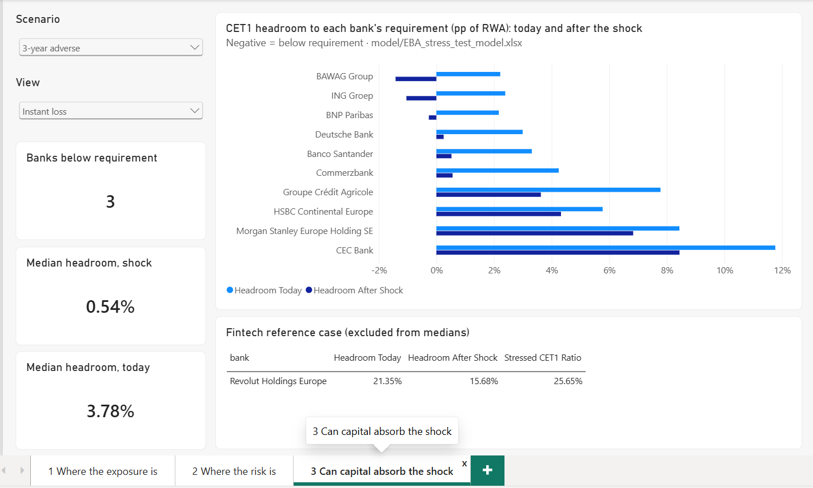

# EBA Credit Risk Analytics

**Where does credit risk sit in the EU banking system, and could large EU banks absorb the NPE shock from the ECB's 2025 stress test with the capital they hold today?**

An analysis of the EBA 2025 EU-wide Transparency Exercise (119 banks, 30 June 2025): 40 SQL queries on concentration, geography, sector and asset quality, and a stress model that measures each bank's distance to its own CET1 requirement under four ECB-based scenarios.

## Headline

- Ten core banks start with a median of **3.8 pp** of CET1 headroom above their requirement.
- A **3-year adverse** NPE shock (+4.1 pp, ECB 2025) absorbed by existing capital alone cuts the median to **0.5 pp**. **BAWAG, ING and BNP Paribas** fall below their requirement.
- With earnings at the June 2025 run rate, no bank breaches. Resilience to a severe, prolonged shock depends on continued profitability.
- In the portfolio, **real estate** is the largest sector (25.5% of classified exposure). **Construction** is the weakest (NPE rate 6.4%, impairment ratio 4.1%). The system NPE ratio improved from 2.24% to 2.14% over the year.

Full summary: [docs/00_executive_summary.md](docs/00_executive_summary.md)

**Explore it:** [web page](https://agrawallachanchal.github.io/eba-credit-risk-analytics/), with the 40 queries runnable in the browser and an adjustable stress test.



## Repository

| Path | Content |
|---|---|
| [`docs/`](docs/) | Executive summary, project defense, methodology, assumptions, limitations, validation log, SQL question log, data dictionary, references |
| [`sql/`](sql/) | Schema, load scripts and 40 analytical queries, one file per question |
| [`model/`](model/) | Stress-test workbook (live formulas), sourced CET1 requirements, model notes |
| [`dashboard/`](dashboard/) | Power BI report (`.pbix` and text-based project), DAX measures, build script, screenshots |
| [`web/`](web/) | Static web page: overview, the queries run live in the browser (DuckDB-WASM), interactive stress test |
| [`data/`](data/) | Download instructions and metadata; raw files are not stored |

## Reproduce

1. Download `tr_cre.csv` and `tr_oth.csv` as described in [data/README.md](data/README.md) and place them in `data/raw/`.
2. Build the database:
   ```bash
   createdb eba
   psql -d eba -f sql/00_setup/01_create_tables.sql
   psql -d eba -f sql/00_setup/02_load_data.sql
   psql -d eba -f sql/00_setup/03_fix_known_issues.sql
   ```
3. Run any query in `sql/`. `sql/08_model_inputs/q33_stress_model_inputs.sql` produces the model's input sheet.
4. Open `model/EBA_stress_test_model.xlsx`. Change the yellow cells on `Assumptions` to run alternative scenarios.

## Method in brief

Shock (ECB 2025 NPE path) × gross loans → new NPE × bank's own coverage → provisions → stressed CET1 ÷ constant RWA → headroom to the bank's published CET1 requirement. Limitations, with the direction of each bias, are in [docs/04_limitations_model_risk.md](docs/04_limitations_model_risk.md).

## Source

Data: European Banking Authority, EU-wide Transparency Exercise 2025, reproduced with acknowledgement under the EBA legal notice. Scenario: ECB, *2025 stress test of euro area banks – Final results*. Full list in [docs/references.md](docs/references.md).

Educational analysis of public data. Not investment advice.

## Author

Chanchal Agrawalla · [GitHub](https://github.com/agrawallachanchal)

## Licence

[MIT](LICENSE) for code and documentation. EBA data remain subject to the EBA's terms.
